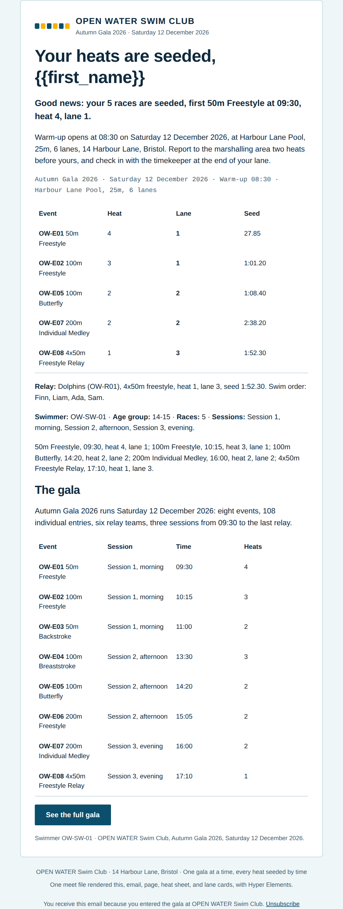
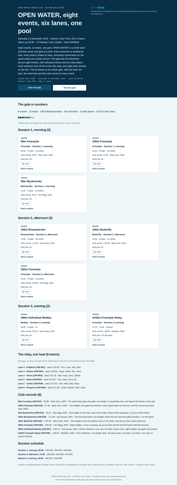
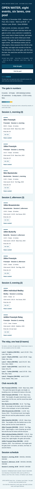
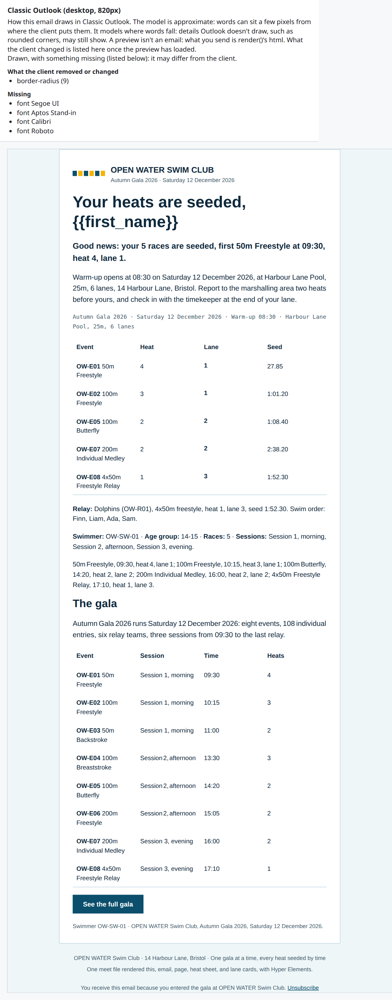
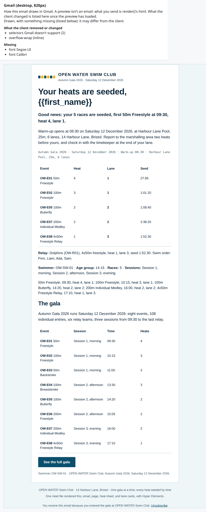

# OPEN WATER, Eight events, six lanes, one pool

A Hyper Elements template kit for a swim club's gala meet.
**One meet file** (`src/data/meet.ts`) renders
everything a gala needs, the swimmer email, the public
meet page, the printed heat sheet as a real PDF, and the
square lane cards, from **one theme** and **one set of
shared components**.


*Every screenshot in this README is a photograph of a real render
(`npm run render` + `npm run shots`): if it is pictured, it was rendered.*

**Measured on the demo run (24 Nov 2026):** one meet file →
**40 personalised swimmer emails**, a **16-page heat-sheet
PDF** (one A4 PDF: gala cover, eleven event pages, sessions and
records, three swimmer index pages), **9 lane cards** (gala cover + one per
event) gate at **0 errors, 0 warnings**, batch in **5.0s**.
Reproduce it: `npm run check && npm run make`, then read
`out/checks.json` and `out/batch.json`.

| The email (600px) | The page (desktop) | The page (mobile) |
|---|---|---|
|  |  |  |

| The heat sheet (A4) | The email in Outlook | The email in Gmail |
|---|---|---|
|  |  |  |

The lane card PNG itself is in
[`examples/lane-card.png`](examples/lane-card.png).

## Why a swim gala?

A gala's paperwork fails in a predictable way: the email says one
heat, the poolside sheet another, and the swimmer reports to the
wrong lane, a different heat, a different seed time. This kit makes
that impossible by construction. Every event code, seed time, heat
and lane lives in **one meet file**; the email quotes it, the page's
cards carry it, and the printed heat sheet prints it next to the
secretary's note. Heats and lanes are not typed, they are derived
from the seed times by a fixed rule: fastest swimmers in the last
heat, fastest in lane 3, then 4, 2, 5, 1, 6. The **LaneStrip**, one
square per event, coloured by session, is the gala drawn as eight
lanes, and it is built from `Row`s of fixed-width `Column`s so it
survives in an inbox that blocks images and in a PDF that never
loads one.

## The four outputs

| Output | Root | Script | What it is |
|---|---|---|---|
| Swimmer email | `Email` → `render()` | `templates/swimmer-email.tsx` | The news leads, your heats are seeded, with the heat, lane and seed of every race, the relay team and swim order, a MergeTag greeting, plain-text twin from the same render |
| Meet page | `Page` → `render()` | `templates/meet-page.tsx` | Deep water hero, the eight-event lane strip, every event as a typed `swim.EventCard` grouped by session, the relay, the club records, the session schedule, phone styles, no client-side JavaScript |
| Heat sheet | `Document` → `renderPdf()` | `templates/heat-sheet-document.tsx` | Sixteen A4 pages, the gala (numbers, how to read an event), eight events with twelve seeded entries per page, sessions, club records, a swimmer index, and the secretary's note, `PageHeader`/`PageFooter` with `PageNumber` |
| Lane cards | `Canvas` → `renderImage()` | `templates/lane-card.tsx` | 1080×1080 PNGs, the gala cover, plus one card per event with the session, heats, club record and a six-lane visual in poster type |

## Run it

```bash
npm install
npm run check        # validate() gate: core + lint + email-clients -> out/checks.json
npm run render       # one of each output -> out/
npm run clients      # the email as Outlook / Gmail / Apple Mail draw it -> out/clients/
npm run make         # 40 swimmer emails + heat sheet + 9 lane cards -> out/swimmers/, out/batch.json
npm run make:sample  # 4 emails, for a quick look
npm run shots        # screenshots of the real outputs -> docs/
```

Node 20+. `examples/` holds one artefact of each kind.

## The gala

OPEN WATER Swim Club, Autumn Gala 2026,
Saturday 12 December 2026, warm-up 08:30,
Harbour Lane Pool, 25m, 6 lanes, 14 Harbour Lane, Bristol.
Eight events, 19 heats, 108 individual entries, 40 swimmers,
6 relay teams, 3 sessions, 8 club records on the line, £720
in entry fees. The data file is the whole product: change the
events, the swimmers, the entries or the records, and every output
follows, because every output reads the same file.

## Design

Aquatic minimal: pale aqua paper `#eef6f8`, deep water blue
`#0b4f6c` for shapes and text accents, signal yellow `#f5b301`
for shapes only, mono event codes. Session colours are dark enough
to be text: session 1 deep blue `#0b4f6c`, session 2 aqua
`#16697f`, session 3 is signal yellow for shapes and deep blue
for its text. See
[`docs/design.md`](docs/design.md) for the notes and the build
lessons, including the one that cost a card: a strip without an
explicit width takes an equal share of its Row and pushes the
next block to the far side.
